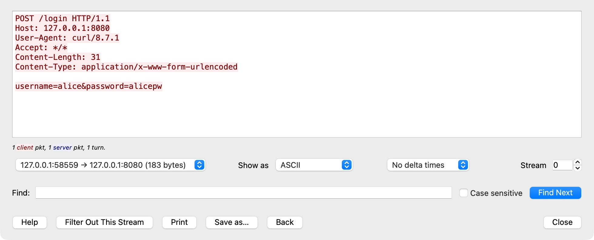
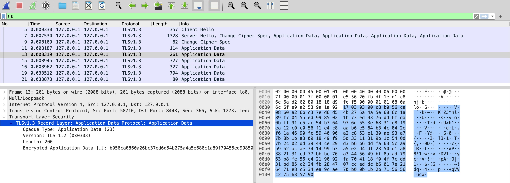

# NotesApp HTTPS Lab

**Name:** Haitian Gao

**Student ID:** 2023903116

**Partner:** 叶与陈 Yuchen Ye

**Partner student ID:** 2023901708

**Date:** 22 October 2026

## 1. HTTP login

The password was readable in Wireshark:

```text
username=alice&password=alicepw
```

- **Who can read it:** In this local test, someone with permission to capture loopback traffic.
- **Severity:** High if the same HTTP login is used on an untrusted network, because the password can be stolen.
- **Fix:** Add Nginx with HTTPS and stop exposing Flask directly.



## 2. HTTPS test

The login still worked at `https://localhost:8443`. Wireshark showed TLS 1.3 application data, and the username and password were no longer readable. HTTP on port 8080 now redirects to HTTPS.

The two captures used the same login sent with curl, without cookies. Chrome login was also checked.



## 3. Certificate check

- **GitHub issuer:** Sectigo Public Server Authentication CA DV E36.
- **Local issuer:** localhost, signed by itself.

Chrome warned about the local certificate because its issuer was not trusted. HTTPS encrypts the connection, but a self-signed certificate does not prove the server's identity through a trusted CA.

**Result:** NotesApp works over HTTPS. The captured password is hidden, but the certificate is still self-signed.

[Lab instructions](https://kristenpire.github.io/epita-security-labs/class5/https-lab/)
