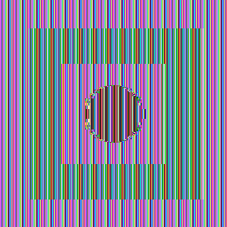
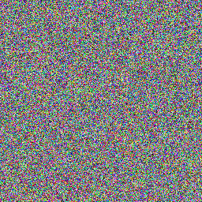

# Class 3 - Symmetric encryption lab

This independent submission contains two reproducible experiments: Caesar frequency analysis and a visual comparison of AES-ECB with authenticated AES-GCM.

## Caesar experiment

`caesar.py` encrypts a sentence with key 7, counts ciphertext letters, assumes the most frequent ciphertext letter corresponds to English `E`, and recovers the key. This heuristic succeeds for the chosen sufficiently repetitive sentence but may fail for short or unusual text.

```text
Original: THE SECRET MESSAGE IS HERE. WE NEED TO KEEP THE MESSAGE SAFE.
Encrypted: AOL ZLJYLA TLZZHNL PZ OLYL. DL ULLK AV RLLW AOL TLZZHNL ZHML.
Guessed key: 7
Decrypted: THE SECRET MESSAGE IS HERE. WE NEED TO KEEP THE MESSAGE SAFE.
```

## ECB and GCM image experiment

The source is a locally generated geometric pattern, avoiding external copyrighted artwork. The same 256-bit AES key encrypts identical RGB bytes:

| Source | AES-ECB visualization | AES-GCM visualization |
|---|---|---|
|  |  |  |

ECB encrypts identical 16-byte blocks identically, so repeated flat-color structure remains visible. GCM uses a nonce and counter construction, producing noise-like ciphertext; it also returns an authentication tag and rejects modification.

## Run and verify

```sh
python class3/caesar.py
python class3/image_modes.py
python -m unittest discover -s class3/tests -v
```

All three tests verify Caesar recovery, AES round trips, and output generation.
